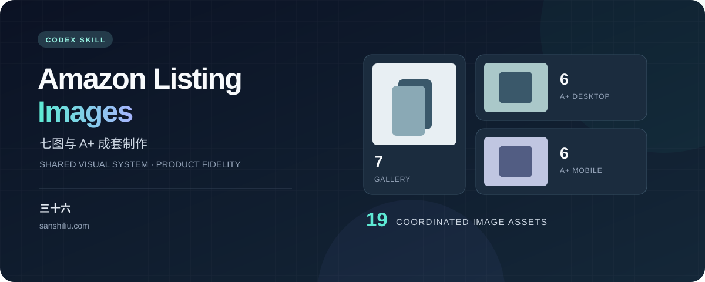

<div align="center">

[](https://sanshiliu.com/)

# Amazon Listing Images

**A shared visual system for product galleries and desktop/mobile A+ images.**

[](SKILL.md)
[](#default-deliverables)
[](https://github.com/sanshiliu-studio/create-amazon-listing-images/actions/workflows/validate.yml)

[中文](README.md) · [Skill instructions](SKILL.md) · [Full user guide, Chinese](使用说明.md) · [Author website](https://sanshiliu.com/)

</div>

## Overview

A Codex skill for planning, generating, revising, and reviewing Amazon US product images. It coordinates the workflow with the image tools available in the current session. The included Python scripts perform read-only file validation; they do not generate images.

**Author: 三十六 · [sanshiliu.com](https://sanshiliu.com/)**

## Default deliverables

| Asset | Count | Specification |
|---|---:|---|
| Product gallery | 7 | 1 main image + 6 secondary images; non-fashion target 2560×2560, fashion target 2304×3072; shortest side strictly above 2000px |
| A+ desktop | 6 | 1464×600 each |
| A+ mobile | 6 | 600×450 each, with a dedicated layout |
| Total | **19** | Shared product facts, colors, lighting, materials, typography, and scene direction |

New production requests include both sets unless the user explicitly limits the scope. Partial revisions and requests to supplement an existing set preserve unrelated images. Missing evidence or unavailable output capabilities remain visible as incomplete items.

## Key rules

- **Product fidelity:** review every final image against the actual SKU references and confirmed facts. Do not invent parts, accessories, dimensions, features, or performance claims.
- **Consistent art direction:** gallery and A+ records reference the same visual specification. A+ uses independently designed compositions.
- **Human lifestyle scenes:** a complete gallery includes at least 2 distinct photorealistic human-use scenes, normally images 03 and 07. Faces remain outside the frame. AI-generated people are not described as actual product photography.
- **Numeric clarity:** use Arabic digits throughout image copy, captions, alt text, and new prompts, including values below 10. Examples: `1.50 in / 3.8 cm`, `2 pieces`, `Step 1`.
- **AI-person disclosure:** applicable files carry the exact `contains-synthetic-performer` keyword in Windows Tags and XMP metadata, with readback verification.
- **Separate reviews:** product fidelity, visual/content review, and file validation are recorded independently.

The gallery covers the main product, core benefit, human scene 1, details, dimensions, usage, and human scene 2. A+ covers positioning, value, materials/construction, usage/styling, fit/dimensions, and remaining purchase questions.

## Installation

Send this in a Codex session supporting local skills:

```text
Use $skill-installer to install the skill from the repository root:
https://github.com/sanshiliu-studio/create-amazon-listing-images
Install it with the name create-amazon-listing-images.
```

Invoke it in a subsequent turn. If it does not appear, reopen Codex. You can also download the repository and attach its `SKILL.md` to a conversation. See the [official skill installation guidance](https://learn.chatgpt.com/docs/build-skills#install-curated-skills-for-local-use).

The file validators use Python 3.11+ and Pillow/ImageCms. Install the pinned dependency when needed:

```sh
python -m pip install -r requirements.txt
```

The scripts do not install dependencies automatically or call a paid image-generation API.

## Quick start

Provide product photographs and confirmed specifications, then send:

```text
$create-amazon-listing-images

Create a coordinated Amazon US gallery and 6 paired A+ groups: 19 images total.
Use a shared visual specification. Gallery images 03 and 07 must show distinct
photorealistic human-use scenes with faces excluded.
A+ desktop: 1464×600. A+ mobile: 600×450, with a dedicated composition.
Use Arabic digits for every numeric value. Review the final product appearance,
structure, dimensions, and claims against the supplied references.
Do not invent missing specifications.

Product and SKU:
Color, material, and finish:
Confirmed dimensions and measurement definitions:
Sold quantity and included items:
Confirmed features and supporting evidence:
Reference images and their roles:
Brand/style references, if available:
```

For a limited task, explicitly request gallery-only, A+-only, content planning without generation, or a named image revision.

## Validation

Verify the actual gallery output and the first desktop/mobile A+ pair before scaling up their respective production paths. Capability failures allow at most 1 materially different, supported correction; repeated failures are reported rather than hidden.

Run these examples from the repository directory with actual image paths:

```sh
python -B -X utf8 scripts/verify_images.py --category other --expected-count 1 gallery-01.jpg
python -B -X utf8 scripts/verify_images.py --category other --aplus-layout desktop --expected-count 1 A01-desktop.jpg
python -B -X utf8 scripts/verify_images.py --category other --aplus-layout mobile --expected-count 1 A01-mobile.jpg
```

Use separate batches for a complete set: gallery count 7, desktop count 6, mobile count 6. Add `--synthetic-performer <path>` for every applicable AI-person file in the current batch.

Checks include dimensions, actual format and matching suffix, sampled ICC behavior or valid PNG sRGB declarations, transparency, animation, byte/exact-pixel duplicates, and required disclosure metadata. A+ also requires a file below 2,000,000 bytes and declared DPI of at least 72 in both directions.

These checks do not recognize product redesigns, true performance, human-scene quality, or text errors. The operator reviews final images against source evidence and records those results separately. The Windows metadata writer supports actual JPEG files; other platforms/formats require separate verification.

## Repository

- [`SKILL.md`](SKILL.md): workflow entry point.
- [`使用说明.md`](使用说明.md): complete Chinese user guide.
- [`references/`](references/): content, fidelity, metadata, and validation procedures.
- [`scripts/`](scripts/): file validators and the Windows metadata writer.
- [`tests/`](tests/): regression tests.

```sh
python -B -X utf8 -m unittest discover -s tests -v
```

Personal product images, generation outputs, and customer records are excluded. Local `outputs/` is ignored.

These export sizes and creative rules are project defaults, not a claim that every Amazon module has the same requirements. Current category rules and platform review remain separate. This independent project is not endorsed by Amazon or OpenAI.

---

**Created by 三十六** · [sanshiliu.com](https://sanshiliu.com/) · [Issues](https://github.com/sanshiliu-studio/create-amazon-listing-images/issues)
