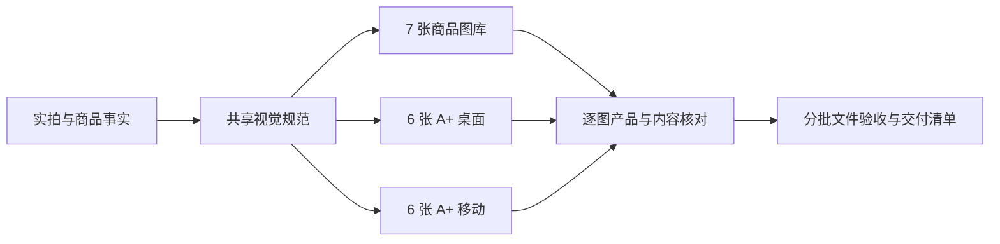

<div align="center">

<a href="https://sanshiliu.com/">
  
</a>

# Amazon Listing Images

**把商品资料，变成视觉统一的亚马逊七图与 A+ 图片。**

[](SKILL.md)
[](#默认交付)
[](https://github.com/sanshiliu-studio/create-amazon-listing-images/actions/workflows/validate.yml)
[](https://sanshiliu.com/)

[快速开始](#快速开始) · [完整使用说明](使用说明.md) · [技能规则](SKILL.md) · [English](README.en.md) · [三十六的网站](https://sanshiliu.com/)

</div>

---

## 这是什么

面向 Amazon 美国站卖家的 Codex 图像制作技能：先锁定真实商品资料与共同美术方向，再分别设计商品图库、A+ 桌面版和移动版，最后核对产品、文字、内容与文件规格。

它负责组织生图与验收流程；实际生成和编辑依赖当前会话可用的图像工具，仓库中的 Python 脚本负责只读文件检查。

## 默认交付

| 图片类型 | 数量 | 规格与内容 |
|---|---:|---|
| 商品图库 | **7** | 1 张白底主图＋6 张副图；非时尚类目标 2560×2560，时尚类目标 2304×3072；短边严格大于 2000px |
| A+ 桌面版 | **6** | 每张 **1464×600** |
| A+ 移动版 | **6** | 每张 **600×450**，重新排版 |
| 合计 | **19** | 共用商品事实、配色、光线、材质、字体与场景气质 |

没有限定范围的新制作任务，默认同时制作 2 套。明确要求只做图库、只做 A+、补图、单张或局部修改时，仅执行指定范围。缺资料或工具无法达标时如实记录未完成项，不降低规格凑数。

## 为什么做成一套

| 关注点 | 技能如何处理 |
|---|---|
| **商品别被 AI 改造** | 逐张对照本款实拍和已确认资料，检查外观、结构、颜色、数量、配件、尺寸与功能卖点 |
| **主图与 A+ 风格统一** | 共用 1 份视觉规范，按不同画幅设计独立画面，交付前跨套核对 |
| **场景有真实使用感** | 完整图库至少 2 张写实人物使用场景，默认第 3、7 张；避开人脸，人物须实际使用商品 |
| **数字清楚易读** | 数值、数量、步骤统一用阿拉伯数字，例如 `1.50 in / 3.8 cm`、`2 pieces`、`Step 1` |
| **人物披露写进文件** | 适用图片写入并验证 `contains-synthetic-performer`，不把标签画在图片上 |
| **验收有实际依据** | 分开记录产品一致性、视觉/内容与文件检查结果，不用像素通过代替产品核验 |

### 7 张图库怎么分工

| 图号 | 内容 |
|---|---|
| 01 | 白底主图：准确展示本次售卖的商品与数量 |
| 02 | 核心卖点：用有依据的信息解释购买价值 |
| 03 | 真人使用场景 1：可信的日常使用、穿戴或操作 |
| 04 | 材质与结构：参考支持的真实细节 |
| 05 | 尺寸：真实数据、正确测量对象、in/cm 双单位 |
| 06 | 使用方式：操作、搭配、安装或收纳 |
| 07 | 真人使用场景 2：不同使用情境，不重复第 3 张 |

A+ 默认 6 组内容：**产品定位 → 核心价值 → 材质结构 → 使用搭配 → 尺寸适配 → 顾虑解答**。每组分别制作桌面与移动图，不直接复制已发布的图库成图。

## 安装

在支持本地技能的 Codex 会话中发送：

```text
使用 $skill-installer，从以下 GitHub 仓库根目录安装技能，
技能名称为 create-amazon-listing-images：
https://github.com/sanshiliu-studio/create-amazon-listing-images
```

安装后在新一轮对话调用；没有出现时重新打开 Codex。也可先下载仓库，在对话中附上本目录的 `SKILL.md`，要求按该技能执行。[官方技能安装说明](https://learn.chatgpt.com/docs/build-skills#install-curated-skills-for-local-use)

需要运行文件验收时，使用 Python 3.11+ 与 Pillow/ImageCms。本项目固定依赖版本便于复现检查：

```sh
python -m pip install -r requirements.txt
```

Windows 启动器也可寻找已安装的可用环境；脚本本身不会自动安装依赖、调用生图 API 或修改待检查图片。

## 快速开始

上传商品实拍与必要细节，复制并补充：

```text
$create-amazon-listing-images

请根据以下资料成套制作亚马逊美国站七图与 6 组 A+ 双端图，共 19 张。
两套共用视觉规范；图库第 3、7 张采用不同的写实人物使用场景，避开人脸。
A+ 桌面 1464×600、移动 600×450，移动版重新排版。
所有数字用阿拉伯数字；生成后逐张核对是否改动商品外观、结构或功能卖点。
信息足够时直接执行，缺失的真实参数不要猜测。

商品名称与 SKU：
颜色、材质与表面处理：
真实尺寸及测量对象：
售卖数量与实际包含物：
已确认功能与卖点及其依据：
参考图片及每张用途：
已有品牌视觉规范：（可选）
```

### 只做部分内容

```text
只规划 6 组 A+ 的内容、构图和英文文案，暂不生成图片。
```

```text
已有七图，请只补 6 组 A+，继承现有风格，图库保持原样。
```

```text
只修改 A03 移动版背景，保留商品、文案和其余细节，另存新版本。
```

更完整的资料模板、规格、异常处理和修改方法见 [使用说明](使用说明.md)。

## 从资料到交付



先用图库首张和 A+ 首组双端的实际文件验证对应输出能力与风格。尺寸不达标仅在有受支持的不同方案时纠正 1 次，同类能力限制不反复重试；可行路径继续，受限部分明确记录。

### 文件验收示例

在仓库目录执行，将示例路径替换为实际文件：

```sh
# 商品图库单张；整套使用 --expected-count 7 并传入 7 个文件
python -B -X utf8 scripts/verify_images.py --category other --expected-count 1 gallery-01.jpg

# A+ 分桌面、移动分别检查；默认整套每端 6 张
python -B -X utf8 scripts/verify_images.py --category other --aplus-layout desktop --expected-count 1 A01-desktop.jpg
python -B -X utf8 scripts/verify_images.py --category other --aplus-layout mobile --expected-count 1 A01-mobile.jpg
```

含 AI 人物/人体的文件另加 `--synthetic-performer <该图路径>`。Windows 写入方法见 [人物元数据标记](references/synthetic-performer.md)。

文件检查包含真实尺寸、格式与后缀、色彩配置、透明像素、静态帧、字节与精确像素去重，以及指定人物图的披露标签。A+ 另查文件小于 **2,000,000 字节**、双向 DPI 至少 **72**。

这些文件检查不自动识别商品改形、功能真实性、人物场景或文字错误；它们由执行者查看最终图片与原始资料，按 [产品一致性终检](references/product-consistency.md) 单独记录。

## 仓库导航

| 路径 | 用途 |
|---|---|
| [`SKILL.md`](SKILL.md) | 技能入口与默认规则 |
| [`使用说明.md`](使用说明.md) | 中文操作与调用模板 |
| [`agents/openai.yaml`](agents/openai.yaml) | Codex 展示名称与默认调用提示 |
| [`references/`](references/) | A+ 规划、内容规则、产品终检及文件验收说明 |
| [`scripts/`](scripts/) | 只读文件验收与 Windows 人物元数据写入 |
| [`tests/`](tests/) | 验收脚本的回归测试 |

```sh
python -B -X utf8 -m unittest discover -s tests -v
```

仓库不包含个人商品实拍、生成结果或客户资料；本地 `outputs/` 默认忽略。用户自行生成的文件留在自己的项目中。

## 使用边界

- 需要当前会话具备可用的图像工具；只安装技能不会自动获得生图能力。
- 缺实拍的概念图、缺依据的卖点、未验证的规格均明确标注，不当作实物还原结果。
- 本仓库的画幅、人物场景和数字显示规则是技能交付约定；Amazon 当前类目要求与内容审核需分别核对。
- Windows 人物元数据写入工具只支持真实 JPEG；其他格式或平台须按对应说明验证。
- 本项目独立维护，不代表 Amazon 或 OpenAI 的官方审核或背书。

---

<div align="center">

**作者：三十六** · [sanshiliu.com](https://sanshiliu.com/)

[使用问题与反馈](https://github.com/sanshiliu-studio/create-amazon-listing-images/issues) · [更多作品与分享](https://sanshiliu.com/)

</div>
