# 酒红金扣女士腰带 · 图片制作示例

[返回仓库首页](../../README.md) · [交互预览文件](index.html) · [作者：三十六](https://sanshiliu.com/)

本示例由作者明确选择公开，展示同一商品的 **7 张图库＋6 组 A+ 双端，共 19 张**。图片直接取自作者指定的修订预览页，提取时保留原始 JPEG 字节、实际像素和人物元数据。

**状态：修订预览。** 图库 01 和 A05 桌面版的皮面细纹仍待校准；本示例尚未通过最终实物保真验收，其他图片的精确色彩、材质和比例仍需原片复核。它用于展示成套视觉和修订记录，不作为已通过产品一致性终检或平台审核的证明。

| 类型 | 数量 | 实际尺寸 |
|---|---:|---|
| 商品图库 | 7 | 1086×1448 |
| A+ 桌面 | 6 | 1464×600 |
| A+ 移动 | 6 | 600×450 |

## 商品图库

| 01 · 白底主图 | 02 · 金扣卖点 | 03 · 牛仔裤穿搭 |
|---|---|---|
| [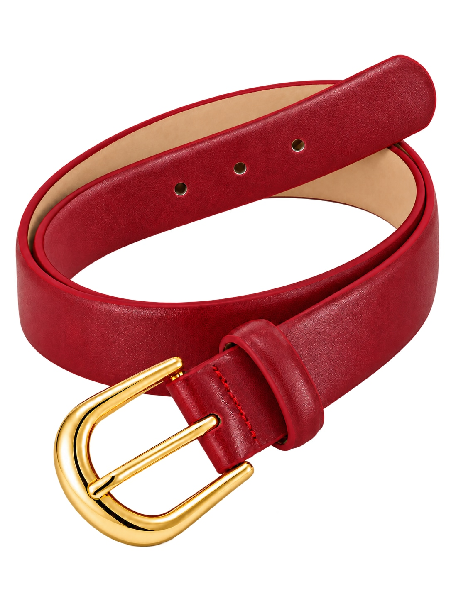](images/01.jpg) | [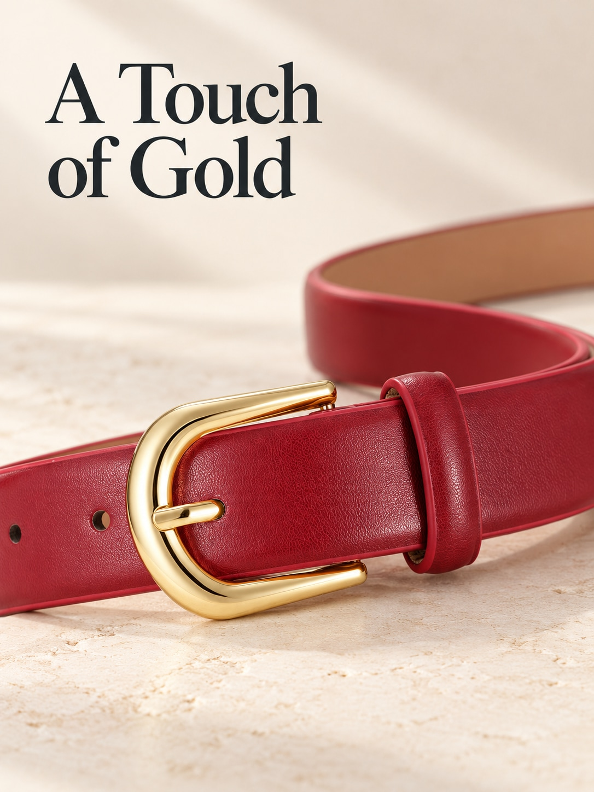](images/02.jpg) | [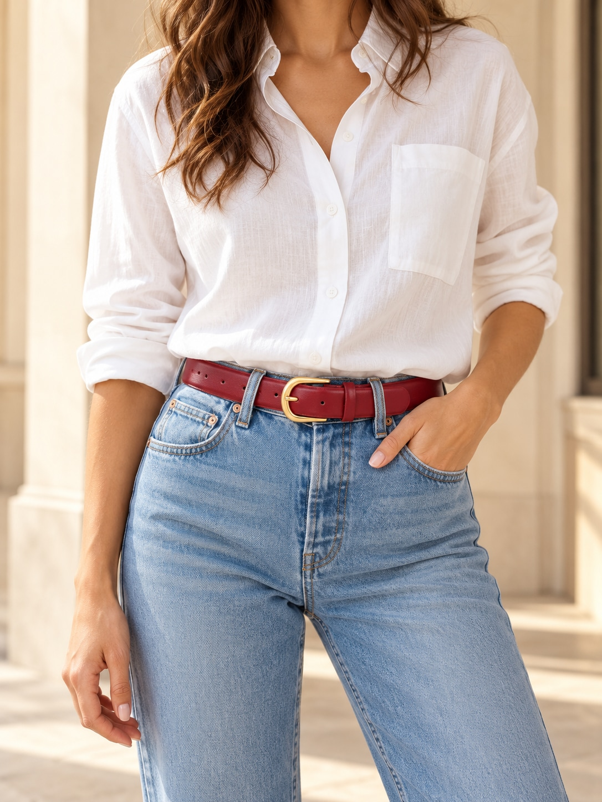](images/03.jpg) |

| 04 · 材质与扣头 | 05 · 尺寸与适配 | 06 · 搭配方式 |
|---|---|---|
| [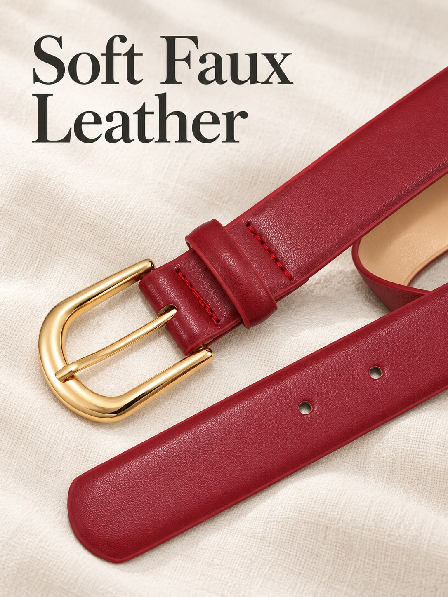](images/04.jpg) | [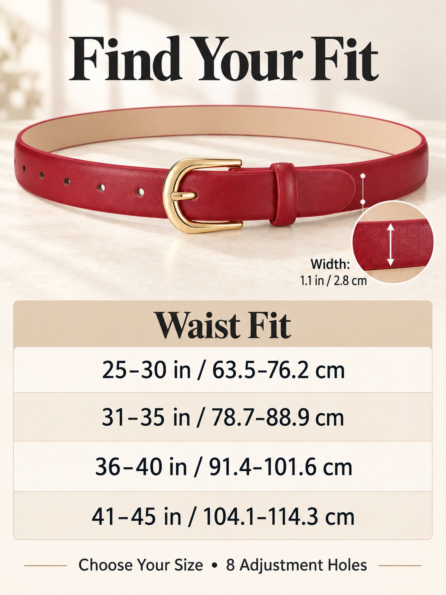](images/05.jpg) | [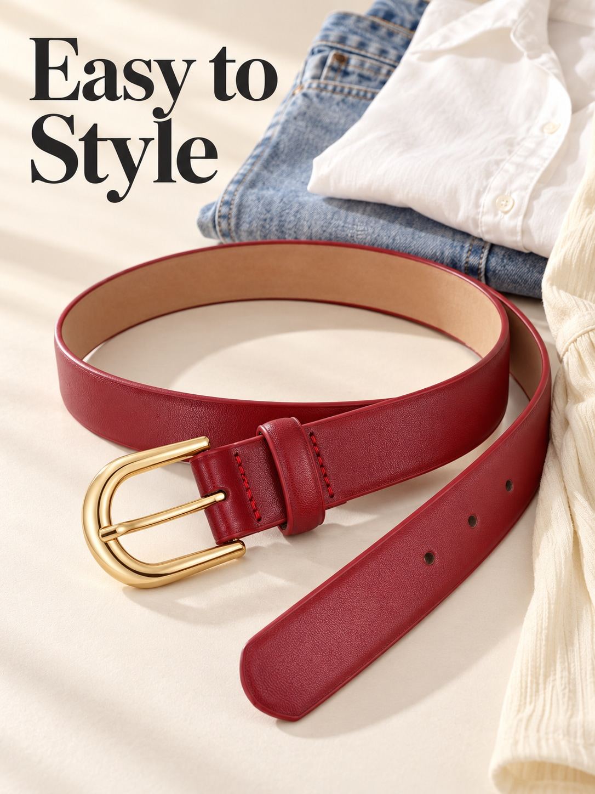](images/06.jpg) |

| 07 · 连衣裙穿搭 |
|---|
| [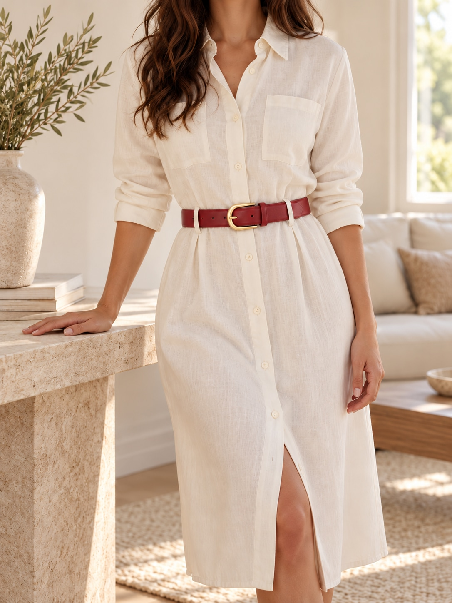](images/07.jpg) |

## A+ 桌面与移动

每组表达同一信息，分别排版；下列图片可点击查看原文件。

### A01 · 产品定位

| 桌面 · 1464×600 | 移动 · 600×450 |
|---|---|
| [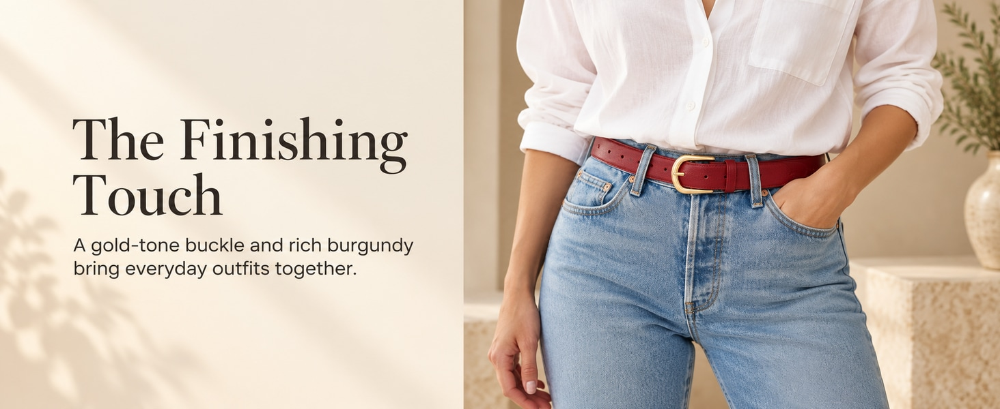](images/A01-desktop.jpg) | [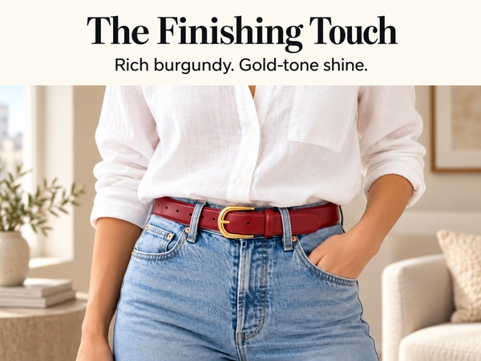](images/A01-mobile.jpg) |

### A02 · 金扣细节

| 桌面 · 1464×600 | 移动 · 600×450 |
|---|---|
| [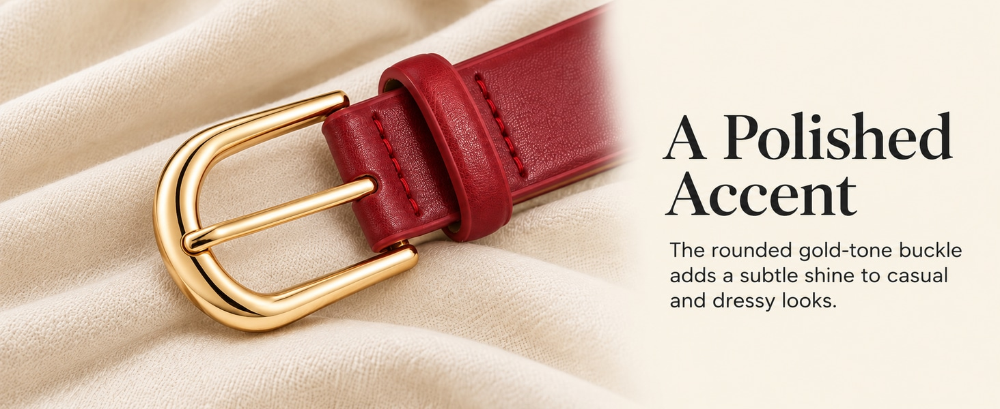](images/A02-desktop.jpg) | [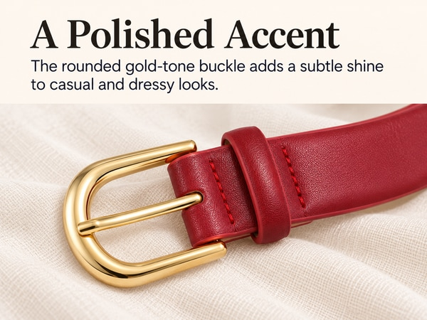](images/A02-mobile.jpg) |

### A03 · 材质与结构

| 桌面 · 1464×600 | 移动 · 600×450 |
|---|---|
| [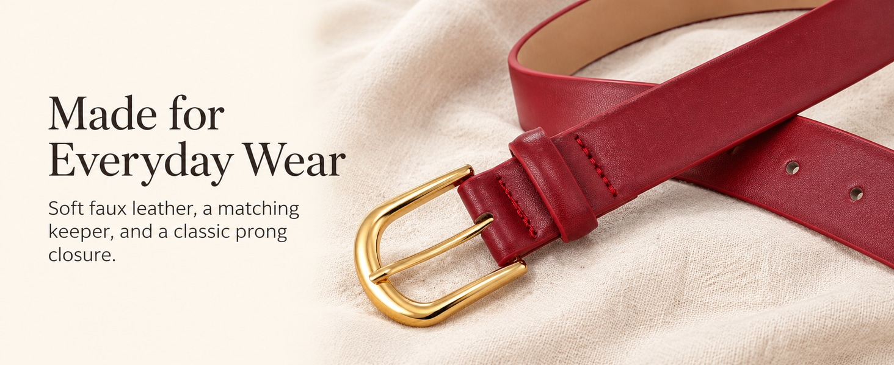](images/A03-desktop.jpg) | [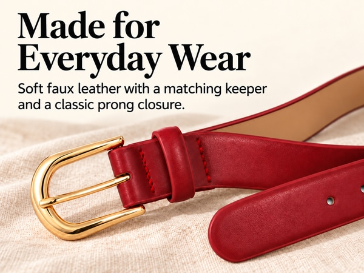](images/A03-mobile.jpg) |

### A04 · 穿搭组合

| 桌面 · 1464×600 | 移动 · 600×450 |
|---|---|
| [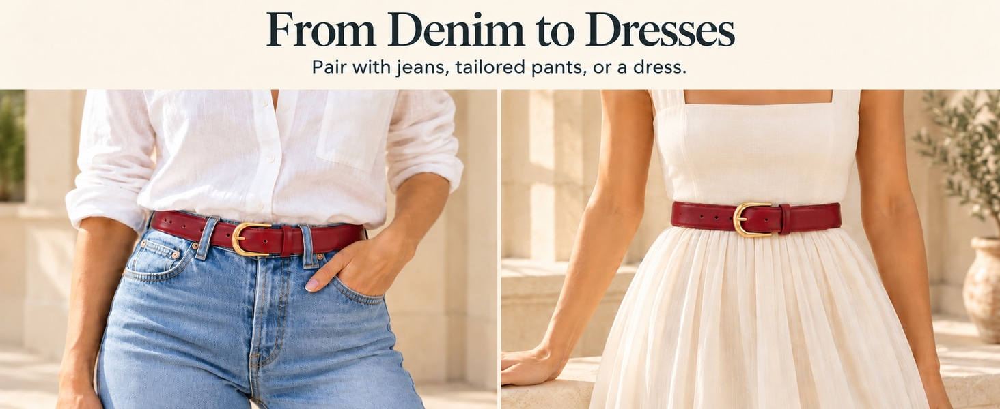](images/A04-desktop.jpg) | [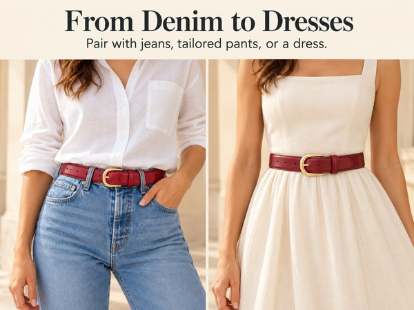](images/A04-mobile.jpg) |

### A05 · 尺码选择

| 桌面 · 1464×600 | 移动 · 600×450 |
|---|---|
| [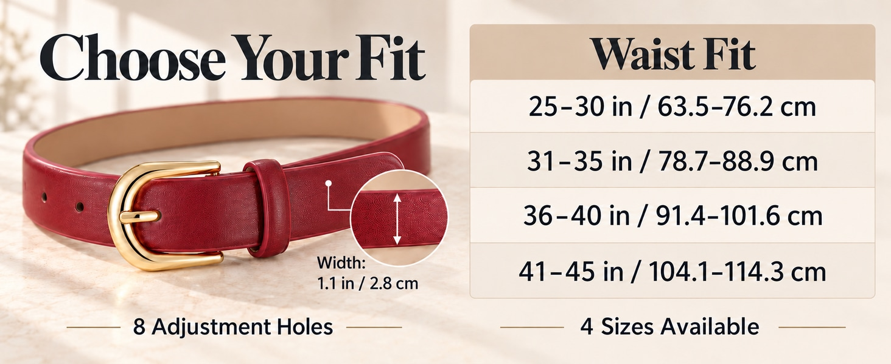](images/A05-desktop.jpg) | [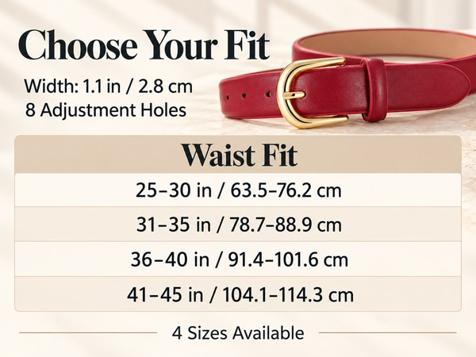](images/A05-mobile.jpg) |

### A06 · 商品包含物

| 桌面 · 1464×600 | 移动 · 600×450 |
|---|---|
| [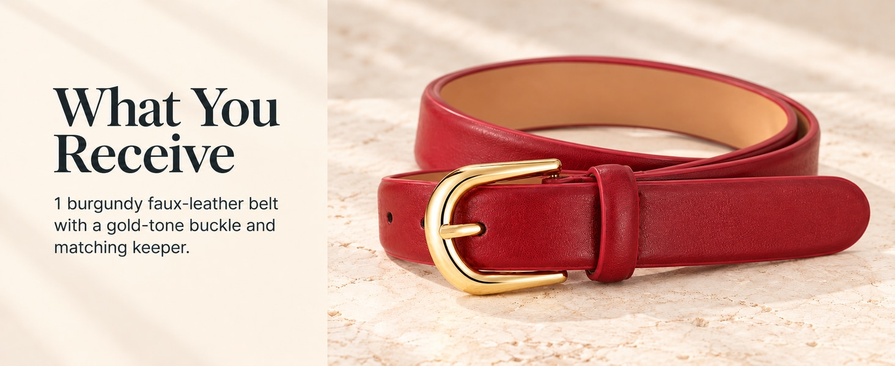](images/A06-desktop.jpg) | [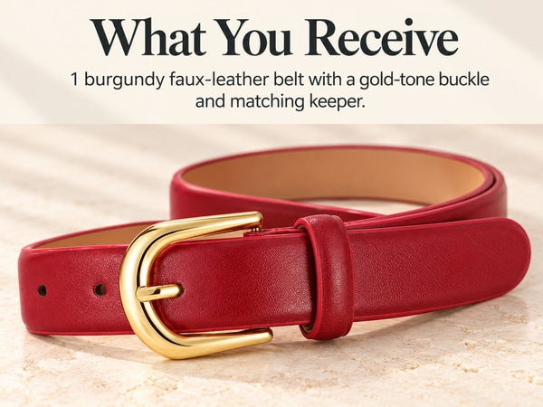](images/A06-mobile.jpg) |

## 交互预览与下载

GitHub 文件页直接显示 HTML 源码；当前页面可直接查看全部 19 张图片。需要筛选、放大、原尺寸查看、键盘切图及逐图检查记录时：

1. [下载仓库 ZIP](https://github.com/sanshiliu-studio/create-amazon-listing-images/archive/refs/heads/main.zip) 并解压。
2. 打开 `examples/burgundy-belt/index.html`，保留旁边的 `images/` 文件夹。
3. 点击图片放大，用左右方向键切换，按 Esc 关闭；也可下载单张 JPEG。

该页面无需联网即可查看，不依赖作者电脑上的本地服务器。各项修订标记与待校准说明保留在交互页中。

## 来源与使用说明

- 作者：**三十六** · [sanshiliu.com](https://sanshiliu.com/)。
- AI 人物场景保持原文件中的 `contains-synthetic-performer` 标记；标签不表示产品或平台审核通过。
- 商品照片、客户资料和其他本地生成记录未随本示例公开。示例中的参数与文案仅属于该案例，不得作为其他商品的事实依据。
- 仓库许可证及第三方材料边界见 [项目说明](../../README.md#开源许可证)。示例图片属于生成输出，不因放入示例目录就自动被重新许可为 AGPL。
